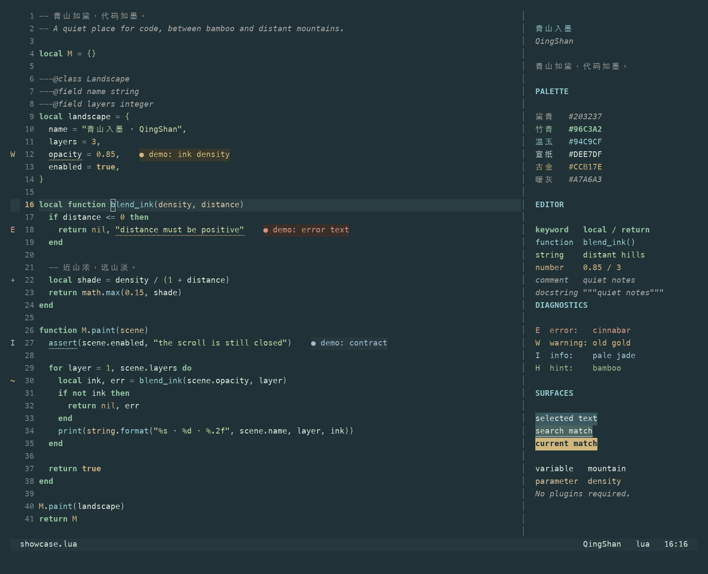
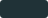
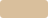
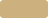

# 青山 · QingShan

> 青山依旧在，几度夕阳红。

> 青山霁后云犹在，画出东南四五峰。

远山敛黛，竹影落纸。以低饱和黛青、温玉与宣纸色，呈现安静清晰的 Neovim 深色主题。



需要 **Neovim 0.10+** 与支持真彩色的终端，无插件依赖。

- 注释暖灰斜体，变量明亮，关键字竹青加粗。
- 支持 Treesitter、LSP 语义高亮、诊断、diff 与终端色。
- 适配 Telescope、nvim-cmp、blink.cmp、Neo-tree、nvim-tree、which-key、gitsigns 等插件。
- 支持透明背景、非活动窗口变暗与高亮覆盖。

Python 函数下方的 `"""docstring"""` 等由 Tree-sitter 识别为
`@string.documentation` 的文档字符串，使用与注释相同的颜色与样式，
并遵循 `styles.comments`；普通字符串保留字符串色。slides 导出中的文档字符串也使用注释色。

## 安装

使用 lazy.nvim：

```lua
{
  "wsgggws/QingShan.nvim",
  lazy = false,
  priority = 1000,
  config = function()
    vim.cmd.colorscheme("qingshan")
  end,
}
```

使用 LazyVim 时，注册主题插件，并设置：

```lua
return {
  { "wsgggws/QingShan.nvim", lazy = true },
  { "LazyVim/LazyVim", opts = { colorscheme = "qingshan" } },
}
```

安装后也可执行 `:colorscheme qingshan`。主题会自动启用 `termguicolors`。

## 配置

`setup()` 可省略；自定义时在加载主题之前调用：

```lua
require("qingshan").setup({
  transparent = false,
  dim_inactive = false,
  terminal_colors = true,
  styles = {
    comments = { italic = true },
    keywords = { bold = true },
  },
  palette = {},
  highlights = {},
})
vim.cmd.colorscheme("qingshan")
```

例如关闭注释斜体、覆盖高亮：

```lua
require("qingshan").setup({
  styles = { comments = { italic = false } },
  highlights = function(p)
    return { CursorLineNr = { fg = p.jade, bold = true } }
  end,
})
```

修改配置后重新执行 `:colorscheme qingshan`。完整选项见 `:help qingshan`。

## 色彩

| 角色 | 色值 | 色样 |
| --- | --- | --- |
| 背景 | `#203237` |  |
| 正文与变量 | `#DEE7DF` |  |
| 注释 | `#A7A6A3` |  |
| 关键字 | `#96C3A2` |  |
| 函数 | `#94C9CF` |  |
| 参数 | `#D9BF9C` |  |
| 字符串 | `#C8D5A4` |  |
| 数字 | `#CCB17E` |  |

黛青背景取远山入墨之色；纸白变量、微暖石灰注释、竹青关键字、冷玉青函数与浅沙参数拉开层级，字体样式作为辅助。完整色板见 [palette.lua](lua/qingshan/palette.lua)。

## 其他配色

其他工具的配色文件见 [extras/](extras/README.md)。

## 预览

```sh
nvim -u scripts/preview.lua
```

开发与截图方法见 [CONTRIBUTING.md](CONTRIBUTING.md)。

## 许可

[MIT](LICENSE)
